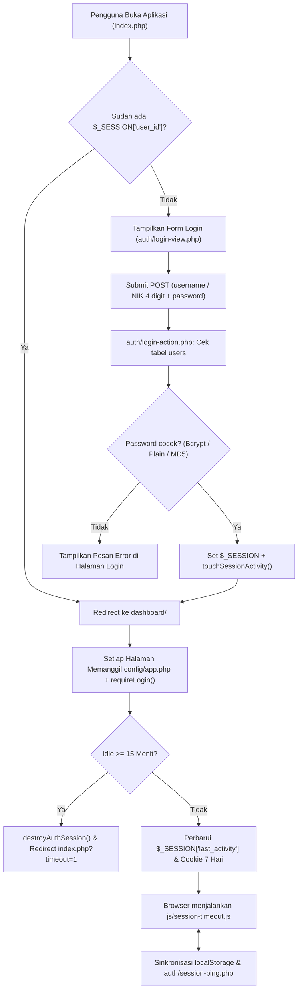
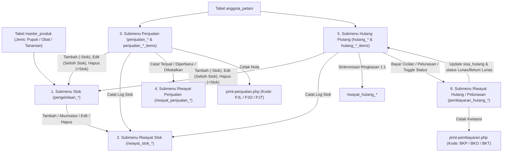
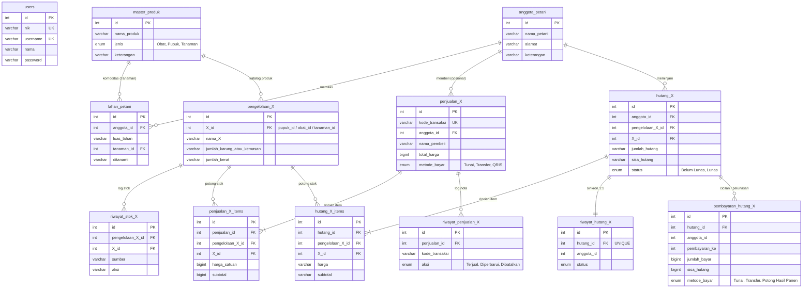

# Peta Arsitektur, Alur Program, dan Database `mudatani99`

Dokumen ini adalah peta referensi utama (**Code & Database Map**) untuk aplikasi web **mudatani99** (Sistem Informasi Kelompok Tani Harapan Makmur). Dokumen ini dirancang agar manusia maupun agen AI dapat memahami struktur file, alur eksekusi program, serta relasi database secara cepat dan akurat sebelum melakukan pembaruan kode.

---

## 1. Ringkasan Sistem & Teknologi

| Komponen | Spesifikasi di Repositori |
| :--- | :--- |
| **Arsitektur** | PHP Native Modular (tanpa framework MVC berat), pola **PRG** (*Post-Redirect-Get*) per modul |
| **Database** | MySQL / MariaDB (`mysqli`), Engine `InnoDB`, Charset `utf8mb4_unicode_ci` |
| **Koneksi DB** | `config/koneksi.php` -> Host `100.10.10.100:3456`, DB `mudatani99`, User `root` |
| **Frontend UI** | Bootstrap 5 (`/assets/bootstrap/...`), Tailwind CSS (`/assets/tailwind/tailwind.css` + CDN fallback), Font Awesome 6.4, Google Fonts `Inter` |
| **Manajemen Sesi** | Cookie 7 hari (`SESSION_COOKIE_LIFETIME`), batas diam (*idle timeout*) **15 menit** (`SESSION_IDLE_TIMEOUT = 900` detik) dengan sinkronisasi lintas tab (`localStorage` + `auth/session-ping.php`) |
| **Penanganan Error DB** | `helpers/db-error.php` -> `dbErrorUntukPengguna()` mencatat error teknis ke `logs/db-error.log` dan mengembalikan pesan aman ke UI |

---

## 2. Peta Direktori & File (`Directory Map`)

```text
mudatani99/
├── index.php                        # Entrypoint utama (Halaman Login)
├── logout.php                       # Penghancur sesi login & redirect ke index.php
├── maps.md                          # Peta arsitektur aplikasi & database (dokumen ini)
│
├── config/
│   ├── app.php                      # Bootstrap sesi, konstanta ROOT_PATH, BASE_URL, APP_ROUTE, appUrl(), requireLogin()
│   └── koneksi.php                  # Instansiasi koneksi MySQL ($conn)
│
├── helpers/
│   └── db-error.php                 # Fungsi dbErrorUntukPengguna() -> tulis ke logs/db-error.log
│
├── auth/
│   ├── login-action.php             # Proses POST login (username ATAU nik 4 digit; Bcrypt / plain / MD5)
│   ├── login-view.php               # Tampilan HTML halaman login + kanvas animasi
│   ├── login.css                    # Styling khusus halaman login
│   ├── login.js                     # Interaksi UI login (toggle password, efek parallax/partikel)
│   └── session-ping.php             # Endpoint JSON (?mode=ping / ?mode=check) untuk cek/perpanjang sesi
│
├── layouts/
│   ├── header.php                   # Tag <head>, muat CSS global + $extraCss
│   ├── sidebar.php                  # Definisi $sidebarMenu, deteksi menu aktif (APP_ROUTE & $_GET['view'])
│   ├── topbar.php                   # Judul halaman aktif, tanggal server Indonesia, profil & tombol logout
│   ├── footer.php                   # Muat JS global (sidebar.js, session-timeout.js) + $extraJs
│   └── placeholder.php              # Template halaman placeholder untuk modul yang belum berisi tabel CRUD
│
├── css/
│   ├── base.css                     # Variabel warna, tipografi, animasi dasar
│   ├── sidebar.css                  # Styling sidebar responsif (collapse desktop & drawer mobile)
│   ├── dashboard.css                # Styling topbar, layout utama, dan kartu placeholder
│   └── data-page.css                # Styling standar halaman data (stats, tabel, modal, filter, toast, tab)
│
├── js/
│   ├── sidebar.js                   # Toggle sidebar, accordion submenu, dropdown profil, auto Title Case input
│   └── session-timeout.js           # Pemantau aktivitas pengguna & auto-logout saat idle >= 15 menit
│
├── dashboard/
│   └── index.php                    # Halaman utama setelah login (menggunakan layouts/placeholder.php)
│
├── master/
│   ├── user/                        # Modul Master -> User (tabel: users)
│   │   ├── index.php                # Entrypoint modul Master User
│   │   ├── helpers.php              # formatTitleCase()
│   │   ├── actions.php              # POST action: add, edit, delete user
│   │   ├── data.php                 # Query daftar user, saran NIK 4 digit berikutnya ($nextSuggestedNik), toast
│   │   ├── script.js                # Pencarian tabel, modal edit/hapus, toast notifikasi
│   │   └── views/                   # stats.php, tabel.php, modal-tambah.php, modal-edit.php, modal-hapus.php, toast-config.php
│   │
│   └── obat-pupuk/                  # Modul Master -> Obat, Pupuk, dan Tanaman (tabel: master_produk)
│       ├── index.php                # Entrypoint modul Master Produk
│       ├── actions.php              # Auto-DDL master_produk + POST action: add, edit, delete
│       ├── data.php                 # Query master_produk, hitung per jenis (Obat/Pupuk/Tanaman), sorting kolom
│       ├── style.css & script.js    # Filter jenis, pencarian, modal, dan toast
│       └── views/                   # stats.php, tabel.php, modals.php, toast-config.php
│
├── anggota/                         # Modul Data Anggota (2 tab view: daftar & lahan)
│   ├── index.php                    # Entrypoint modul Data Anggota
│   ├── helpers.php                  # Auto-DDL anggota_petani, master_produk, lahan_petani + penentu $activeView
│   ├── actions.php                  # POST action: add/edit/delete (anggota) & add_lahan/edit_lahan/delete_lahan
│   ├── data.php                     # Query anggotaList, tanamanList (jenis='Tanaman'), lahanList, totalLuasHa
│   ├── style.css & script.js        # Interaksi modal anggota & lahan, filter, pencarian, toast
│   └── views/                       # tabs.php, view-anggota.php, view-lahan.php, modals-anggota.php, modals-lahan.php, toast-config.php
│
├── pupuk/                           # Modul Inventaris Pupuk (6 tab view, satuan: Karung & Kg)
├── obat/                            # Modul Inventaris Obat (6 tab view, satuan: Pcs/Botol & Kg)
├── tanaman/                         # Modul Inventaris Tanaman (6 tab view, satuan: Pcs & Kg)
│   ├── index.php                    # Entrypoint & router tampilan untuk 6 view inventaris
│   ├── helpers.php                  # Auto-DDL 9 tabel inventaris + fungsi stok, item transaksi, kode nota, sinkronisasi
│   ├── actions.php                  # Dispatcher POST ke subfolder actions/
│   ├── actions/
│   │   ├── stok.php                 # POST: add (akumulasi/baru), edit, delete stok
│   │   ├── penjualan.php            # POST: add_penjualan, edit_penjualan, delete_penjualan
│   │   ├── hutang.php               # POST: add_hutang, edit_hutang, delete_hutang
│   │   └── pembayaran.php           # POST: pay_hutang (cicilan/pelunasan), toggle_status_hutang
│   ├── data.php                     # Query seluruh tabel untuk 6 view + konfigurasi flash toast
│   ├── print-penjualan.php          # Halaman cetak nota penjualan (?id=...&auto=1)
│   ├── print-pembayaran.php         # Halaman cetak bukti pembayaran hutang (?id=...&auto=1)
│   ├── style.css & script.js        # Logika multi-item form, kalkulasi otomatis berat & subtotal, filter, modal, toast
│   └── views/
│       ├── tabs.php                 # Navigasi 6 tab submenu
│       ├── view-stok.php            # Tampilan tab 1: Stok
│       ├── view-riwayat-stok.php    # Tampilan tab 2: Riwayat Stok
│       ├── view-penjualan.php       # Tampilan tab 3: Penjualan
│       ├── view-riwayat-penjualan.php # Tampilan tab 4: Riwayat Penjualan
│       ├── view-hutang.php          # Tampilan tab 5: Hutang Piutang
│       ├── view-riwayat.php         # Tampilan tab 6: Riwayat Hutang / Pelunasan
│       ├── modals-stok.php          # Modal tambah, edit, hapus stok
│       ├── modals-penjualan.php     # Modal tambah, edit, hapus penjualan (multi-item)
│       ├── modals-hutang.php        # Modal tambah, edit, hapus hutang (multi-item)
│       ├── modals-bayar.php         # Modal input pembayaran/cicilan hutang
│       ├── modal-info.php           # Modal peringatan informasi (mis. stok tidak cukup)
│       └── toast-config.php         # Injeksi objek JS toast ke window.*_TOAST
│
├── ai/index.php                     # Halaman placeholder Penyuluh Pertanian AI Pintar
├── transaksi/index.php              # Halaman placeholder Kas & Transaksi
├── pengaturan/index.php             # Halaman placeholder Pengaturan Sistem
│
└── database/                        # Kumpulan file SQL terstruktur per menu & submenu
    ├── 01-master/
    ├── 02-data-anggota/
    ├── 03-inventaris-pupuk/
    ├── 04-inventaris-obat/
    └── 05-inventaris-tanaman/
```

---

## 3. Peta Navigasi, Rute, & Submenu (`Route Map`)

Menu navigasi didefinisikan secara terpusat di `layouts/sidebar.php` melalui array `$sidebarMenu`. Status aktif ditentukan dari konstanta `APP_ROUTE` dan parameter query `$_GET['view']`.

| Kelompok Menu | Menu / Submenu | Rute (`APP_ROUTE`) | Parameter `?view=` | File View Utama | Tabel Database Utama |
| :--- | :--- | :--- | :--- | :--- | :--- |
| **Menu Utama** | Ringkasan Dashboard | `dashboard` | - | `layouts/placeholder.php` | - |
| **Data Master** | Master -> User | `master/user` | `null` | `master/user/views/tabel.php` | `users` |
| **Data Master** | Master -> Obat, Pupuk, dan Tanaman | `master/obat-pupuk` | `null` | `master/obat-pupuk/views/tabel.php` | `master_produk` |
| **Manajemen Poktan** | Data Anggota -> Daftar Anggota Petani | `anggota` | `null` (`daftar`) | `anggota/views/view-anggota.php` | `anggota_petani` |
| **Manajemen Poktan** | Data Anggota -> Pemetaan & Luas Lahan | `anggota` | `lahan` | `anggota/views/view-lahan.php` | `lahan_petani`, `anggota_petani`, `master_produk` |
| **Manajemen Poktan** | Inventaris Pupuk -> Stok Pupuk | `pupuk` | `null` (`kelola`) | `pupuk/views/view-stok.php` | `pengelolaan_pupuk` |
| **Manajemen Poktan** | Inventaris Pupuk -> Riwayat Stok Pupuk | `pupuk` | `riwayat_stok` | `pupuk/views/view-riwayat-stok.php` | `riwayat_stok_pupuk` |
| **Manajemen Poktan** | Inventaris Pupuk -> Penjualan | `pupuk` | `penjualan` | `pupuk/views/view-penjualan.php` | `penjualan_pupuk`, `penjualan_pupuk_items` |
| **Manajemen Poktan** | Inventaris Pupuk -> Riwayat Penjualan | `pupuk` | `riwayat_penjualan` | `pupuk/views/view-riwayat-penjualan.php` | `riwayat_penjualan_pupuk` |
| **Manajemen Poktan** | Inventaris Pupuk -> Hutang Piutang | `pupuk` | `hutang` | `pupuk/views/view-hutang.php` | `hutang_pupuk`, `hutang_pupuk_items` |
| **Manajemen Poktan** | Inventaris Pupuk -> Riwayat Hutang / Pelunasan | `pupuk` | `riwayat` | `pupuk/views/view-riwayat.php` | `pembayaran_hutang_pupuk`, `riwayat_hutang_pupuk` |
| **Manajemen Poktan** | Inventaris Obat -> 6 Submenu Obat | `obat` | `null`, `riwayat_stok`, `penjualan`, `riwayat_penjualan`, `hutang`, `riwayat` | `obat/views/view-*.php` | `pengelolaan_obat` + 8 tabel transaksi/log obat |
| **Manajemen Poktan** | Inventaris Tanaman -> 6 Submenu Tanaman | `tanaman` | `null`, `riwayat_stok`, `penjualan`, `riwayat_penjualan`, `hutang`, `riwayat` | `tanaman/views/view-*.php` | `pengelolaan_tanaman` + 8 tabel transaksi/log tanaman |
| *(Rute Tambahan)* | Penyuluh AI, Transaksi, Pengaturan | `ai`, `transaksi`, `pengaturan` | - | `layouts/placeholder.php` | *(Placeholder)* |

---

## 4. Skema Alur Program (`Program Flow Map`)

### 4.1. Alur Autentikasi & Sesi Idle Timeout (15 Menit)



### 4.2. Siklus Eksekusi Request pada Setiap Modul (`Request Lifecycle`)

Setiap halaman modul (`master/user`, `master/obat-pupuk`, `anggota`, `pupuk`, `obat`, `tanaman`) mengikuti urutan eksekusi yang seragam:

```mermaid
flowchart LR
    S1["1. config/app.php + requireLogin()"] --> S2["2. config/koneksi.php ($conn)"]
    S2 --> S3["3. helpers.php (Auto-DDL, Migrasi & Fungsi Bantu)"]
    S3 --> S4["4. actions.php (Tangani Request POST & Redirect PRG)"]
    S4 --> S5["5. data.php (Query Data Tabel & Siapkan Flash Toast)"]
    S5 --> S6["6. layouts/header.php + sidebar.php + topbar.php"]
    S6 --> S7["7. views/*.php (Tabs, Stats, Tabel, Modals, Toast Config)"]
    S7 --> S8["8. layouts/footer.php + script.js"]
```



### 4.3. Alur Sinkronisasi Modul Inventaris (`pupuk/`, `obat/`, `tanaman/`)

Ketiga modul inventaris memiliki mesin logika yang identik di dalam folder masing-masing:



**Detail perilaku penting pada Inventaris:**
1. **Akumulasi Stok Otomatis (`actions/stok.php`):** Saat menambah stok produk yang sudah ada di tabel `pengelolaan_*`, sistem tidak membuat baris duplikat, melainkan mengakumulasi jumlah kemasan/karung dan beratnya serta mencatat log `"Akumulasi Stok"` di `riwayat_stok_*`.
2. **Validasi Kuota Stok Multi-Item (`parse*TransactionItems`):** Saat menambah atau mengedit Penjualan maupun Hutang Piutang (mendukung banyak item sekaligus dalam 1 transaksi), sistem menghitung total permintaan per item dan membandingkannya dengan stok tersedia ditambah kuota lama (`build*StockAllowanceFromItems`) sebelum mengizinkan penyimpanan.
3. **Pencegahan Pengurangan Ganda Trigger MySQL:** Setiap request `POST` di `actions.php` menjalankan `$conn->query("SET @disable_hutang_trigger = 1")` agar penyesuaian stok ditangani sepenuhnya oleh fungsi PHP yang tervalidasi.

---

## 5. Peta Perbandingan 3 Modul Inventaris

| Karakteristik | Inventaris Pupuk (`pupuk/`) | Inventaris Obat (`obat/`) | Inventaris Tanaman (`tanaman/`) |
| :--- | :--- | :--- | :--- |
| **Filter `master_produk`** | `jenis = 'Pupuk'` | `jenis = 'Obat'` | `jenis = 'Tanaman'` |
| **Kolom Kuantitas Kemasan** | `jumlah_karung` | `jumlah_kemasan` | `jumlah_kemasan` |
| **Satuan Kemasan** | `Karung` | Pilihan `Pcs` atau `Botol` (ringkasan multi-satuan: `Kemasan`) | `Pcs` |
| **Satuan Berat** | `Kg` (default 50 Kg/Karung jika baru) | `Kg` (default 1 Kg/Kemasan jika baru) | `Kg` (default 10 Kg/Pcs jika baru) |
| **Awalan Kode Nota Penjualan** | `PJL-YYYYMMDD-XXXX` | `PJO-YYYYMMDD-XXXX` | `PJT-YYYYMMDD-XXXX` |
| **Awalan Bukti Pembayaran** | `BKP-YYYYMMDD-XXXX` | `BKO-YYYYMMDD-XXXX` | `BKT-YYYYMMDD-XXXX` |
| **Variabel JS Toast Global** | `window.PUPUK_TOAST` | `window.OBAT_TOAST` | `window.TANAMAN_TOAST` |
| **Fungsi Validasi Multi-Item** | `parsePupukTransactionItems()` | `parseObatTransactionItems()` | `parseTanamanTransactionItems()` |
| **Fungsi Penyesuaian Stok** | `adjustStokPengelolaanPupuk()` | `adjustStokPengelolaanObat()` | `adjustStokPengelolaanTanaman()` |

---

## 6. Peta Skema Database & Relasi (`Database Map`)

Seluruh skrip SQL disimpan di folder `database/` yang dikelompokkan berdasarkan urutan menu. Selain melalui impor file SQL, masing-masing modul juga memiliki fitur *auto-DDL* (`CREATE TABLE IF NOT EXISTS` dan migrasi kolom otomatis) di file `helpers.php` atau `actions.php`.

### 6.1. Diagram Relasi Antar Tabel (`Entity Relationship Diagram`)


*(Catatan: Pada diagram di atas, akhiran `_X` mewakili ketiga domain inventaris yang identik secara struktur: `_pupuk`, `_obat`, dan `_tanaman`.)*

### 6.2. Peta Urutan Eksekusi File SQL & Daftar Lengkap 26 Tabel

Jalankan file SQL sesuai urutan nomor folder (`01` s.d. `05`) dan nomor urut file (`01` s.d. `06`) di dalamnya:

#### A. Folder `database/01-master/`
1. **`01-user.sql`**
   - **`users`**: Menyimpan akun login pengurus/anggota (`id`, `nik` [UNIQUE 4 digit], `username` [UNIQUE], `nama`, `password`, `created_at`).
2. **`02-obat-pupuk-tanaman.sql`**
   - **`master_produk`**: Katalog induk seluruh item (`id`, `nama_produk`, `jenis` [`ENUM('Obat','Pupuk','Tanaman')`], `keterangan`, `created_at`).

#### B. Folder `database/02-data-anggota/`
3. **`01-daftar-anggota-petani.sql`**
   - **`anggota_petani`**: Data profil anggota petani (`id`, `nama_petani`, `alamat`, `keterangan`, `created_at`).
4. **`02-pemetaan-luas-lahan.sql`**
   - **`lahan_petani`**: Data luas lahan dan komoditas yang ditanam petani (`id`, `anggota_id` [FK -> `anggota_petani.id` CASCADE], `luas_lahan`, `tanaman_id` [FK -> `master_produk.id` SET NULL], `ditanami`, `keterangan`, `created_at`).

#### C. Folder `database/03-inventaris-pupuk/` (9 Tabel)
5. **`01-stok-pupuk.sql`** -> **`pengelolaan_pupuk`** (`id`, `pupuk_id` [FK -> `master_produk`], `nama_pupuk`, `jumlah_karung`, `jumlah_berat`, `keterangan`, `created_at`).
6. **`02-riwayat-stok-pupuk.sql`** -> **`riwayat_stok_pupuk`** (`id`, `pengelolaan_pupuk_id` [FK], `pupuk_id` [FK], `nama_pupuk`, `sumber`, `aksi`, `karung_sebelum`, `berat_sebelum`, `perubahan_karung`, `perubahan_berat`, `karung_sesudah`, `berat_sesudah`, `keterangan`, `dicatat_oleh`, `created_at`).
7. **`03-penjualan-pupuk.sql`** ->
   - **`penjualan_pupuk`** (`id`, `kode_transaksi` [UNIQUE `PJL-...`], `anggota_id` [FK], `nama_pembeli`, `alamat_pembeli`, `nama_pupuk`, `jumlah_karung`, `jumlah_berat`, `total_harga`, `metode_bayar`, `tanggal_jual`, `keterangan`, `dicatat_oleh`, `created_at`, `updated_at`).
   - **`penjualan_pupuk_items`** (`id`, `penjualan_id` [FK CASCADE], `pengelolaan_pupuk_id` [FK], `pupuk_id` [FK], `nama_pupuk`, `jumlah_karung`, `jumlah_berat`, `harga_satuan`, `subtotal`, `created_at`).
8. **`04-riwayat-penjualan-pupuk.sql`** -> **`riwayat_penjualan_pupuk`** (`id`, `penjualan_id` [FK SET NULL], `kode_transaksi`, `aksi` [`Terjual`/`Diperbarui`/`Dibatalkan`], `nama_pembeli`, `rincian_item`, `total_karung`, `total_berat`, `total_harga`, `metode_bayar`, `tanggal_jual`, `dicatat_oleh`, `keterangan`, `created_at`).
9. **`05-hutang-piutang-pupuk.sql`** ->
   - **`hutang_pupuk`** (`id`, `anggota_id` [FK CASCADE], `nama_petani`, `pengelolaan_pupuk_id` [FK], `pupuk_id` [FK], `nama_pupuk`, `jumlah_karung`, `jumlah_berat`, `harga`, `jumlah_hutang`, `sisa_hutang`, `keterangan`, `tanggal`, `status` [`Belum Lunas`/`Lunas`], `tanggal_lunas`, `created_at`).
   - **`hutang_pupuk_items`** (`id`, `hutang_id` [FK CASCADE], `pengelolaan_pupuk_id` [FK], `pupuk_id` [FK], `nama_pupuk`, `jumlah_karung`, `jumlah_berat`, `harga`, `subtotal`, `created_at`).
10. **`06-riwayat-hutang-pelunasan-pupuk.sql`** ->
    - **`riwayat_hutang_pupuk`** (Salinan sinkron 1:1 dari `hutang_pupuk` dengan `uniq_hutang_id`, FK CASCADE ke `hutang_pupuk`).
    - **`pembayaran_hutang_pupuk`** (`id`, `hutang_id` [FK CASCADE], `anggota_id`, `nama_petani`, `nama_pupuk`, `pembayaran_ke`, `tanggal_bayar`, `total_hutang`, `sisa_sebelum`, `jumlah_bayar`, `sisa_hutang`, `metode_bayar` [`Tunai`/`Transfer`/`Potong Hasil Panen`], `status`, `keterangan`, `dicatat_oleh`, `created_at`).

#### D. Folder `database/04-inventaris-obat/` (9 Tabel)
11. **`01-stok-obat.sql`** -> **`pengelolaan_obat`** (Kolom kemasan: `jumlah_kemasan` satuan `Pcs`/`Botol`, FK `obat_id` -> `master_produk`).
12. **`02-riwayat-stok-obat.sql`** -> **`riwayat_stok_obat`** (`kemasan_sebelum`, `perubahan_kemasan`, `kemasan_sesudah`, dll.).
13. **`03-penjualan-obat.sql`** -> **`penjualan_obat`** (Kode `PJO-...`) & **`penjualan_obat_items`**.
14. **`04-riwayat-penjualan-obat.sql`** -> **`riwayat_penjualan_obat`** (`total_kemasan`, dll.).
15. **`05-hutang-piutang-obat.sql`** -> **`hutang_obat`** & **`hutang_obat_items`**.
16. **`06-riwayat-hutang-pelunasan-obat.sql`** -> **`riwayat_hutang_obat`** & **`pembayaran_hutang_obat`**.

#### E. Folder `database/05-inventaris-tanaman/` (9 Tabel)
17. **`01-stok-tanaman.sql`** -> **`pengelolaan_tanaman`** (Kolom kemasan: `jumlah_kemasan` satuan `Pcs`, FK `tanaman_id` -> `master_produk`).
18. **`02-riwayat-stok-tanaman.sql`** -> **`riwayat_stok_tanaman`** (`kemasan_sebelum`, `perubahan_kemasan`, `kemasan_sesudah`, dll.).
19. **`03-penjualan-tanaman.sql`** -> **`penjualan_tanaman`** (Kode `PJT-...`) & **`penjualan_tanaman_items`**.
20. **`04-riwayat-penjualan-tanaman.sql`** -> **`riwayat_penjualan_tanaman`** (`total_kemasan`, dll.).
21. **`05-hutang-piutang-tanaman.sql`** -> **`hutang_tanaman`** & **`hutang_tanaman_items`**.
22. **`06-riwayat-hutang-pelunasan-tanaman.sql`** -> **`riwayat_hutang_tanaman`** & **`pembayaran_hutang_tanaman`**.

---

## 7. Panduan Cepat Pembaruan Proyek (Untuk Manusia & AI)

1. **Menambah Menu atau Submenu Baru di Sidebar:**
   - Buka `layouts/sidebar.php` dan tambahkan item pada array `$sidebarMenu`.
   - Jika berupa tab di dalam modul yang sudah ada, tambahkan nilai `'view' => 'nama_view'` lalu tangani nilai `$activeView` tersebut di `index.php`, `actions.php`, `data.php`, dan `views/tabs.php` modul terkait.
   - Jika berupa folder modul baru (1 tingkat dari root), wajib awali `index.php` dengan `require_once __DIR__ . '/../config/app.php';` dan `requireLogin();` (gunakan `/../../config/app.php` jika berada 2 tingkat seperti `master/user/`).

2. **Mengubah Fitur pada Modul Inventaris (`pupuk/`, `obat/`, `tanaman/`):**
   - Ketiga modul inventaris memiliki struktur file yang simetris. Jika suatu perubahan bisnis berlaku untuk semua inventaris, periksa apakah perubahan yang sama perlu diterapkan pada ketiganya (`pupuk/`, `obat/`, `tanaman/`) dengan memperhatikan perbedaan nama kolom (`jumlah_karung` vs `jumlah_kemasan`) dan satuan (`Karung` vs `Pcs/Botol` vs `Pcs`).

3. **Menjaga Sinkronisasi Skema Database:**
   - Setiap kali menambah tabel atau mengubah kolom pada modul, perbarui dua tempat sekaligus:
     1. File SQL yang bersangkutan di dalam `database/0X-.../`
     2. Blok *auto-DDL* / migrasi otomatis di `helpers.php` (atau `actions.php`) modul terkait agar aplikasi tetap berjalan mulus tanpa error meskipun pengguna belum menjalankan ulang skrip SQL secara manual.

4. **Konvensi Input & Notifikasi UI:**
   - **Auto Title Case:** `js/sidebar.js` otomatis mengubah semua `input.modal-input[type="text"]` dan `textarea.modal-input` menjadi *Title Case* (kecuali `username`, `password`, dan `nik`), dan sisi server juga menormalkan teks menggunakan `formatTitleCase()`.
   - **Flash Toast (PRG):** Setelah aksi `POST` berhasil, selalu redirect dengan `header('Location: ' . appUrl('.../?status=...'))` lalu tangkap `$_GET['status']` di `data.php` untuk mengisi `$toastTitle`, `$toastMessage`, dan `$toastType` yang dirender oleh `views/toast-config.php`.
